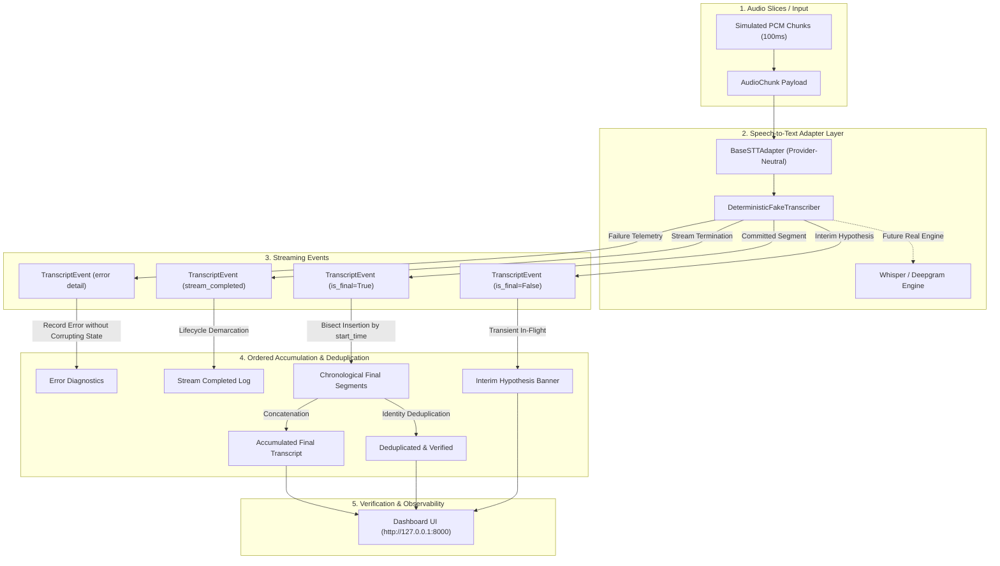

# AI Voice Co-Pilot - Speech-to-Text Pipeline Foundation (Workstream W2)

[]()
[]()
[]()
[]()

> **Engineer:** Disha D K (SDE 3)  
> **Workstream:** W2 – Speech-to-Text Foundation (Week 1, Day 1–Day 7)  
> **Status:** Ready for review  
> **Working Branch:** `feature/w2-speech-to-text-foundation`  

---

## Installation and Setup

### Prerequisites
- Python 3.10 or higher

### 1. Create and activate a virtual environment

**Windows (PowerShell):**
```powershell
python -m venv .venv
.\.venv\Scripts\Activate.ps1
```

**macOS / Linux:**
```bash
python3 -m venv .venv
source .venv/bin/activate
```

### 2. Install the project and development dependencies

```bash
pip install -e ".[dev]"
```

This installs `voice_stt` as an editable package and all test dependencies (`pytest`, etc.).

### 3. Install optional dashboard dependencies

The interactive web dashboard (`demo/server.py`) requires FastAPI and Uvicorn, which are **not** included in the core development dependencies:

```bash
pip install fastapi uvicorn
```

These are only needed if you want to run the dashboard at `http://localhost:8000`. The core library and full test suite work without them.

---

## 1. Overview & Workstream Scope

This repository contains the foundation and first vertical slice of the **Speech-to-Text (STT)** pipeline for **Academia — AI Voice Co-Pilot** (Team SDE 3).

### What Workstream W2 Owns:
- **Canonical Transcript Schemas**: Single shared definition of `TranscriptSegment`, `TranscriptEvent`, and `STTErrorDetail`.
- **Provider-Neutral Adapter**: Abstract interface decoupling transcription from specific commercial vendors.
- **Deterministic Fake Transcriber**: 100% reproducible test double operating offline without paid API keys.
- **Ordered Segment Accumulator**: Chronologically sorts speech segments, isolates interim hypotheses, suppresses duplicates, and reconstructs continuous text.
- **Canonical Demonstration Fixtures**: Six named fixtures (A through F) exercising standard speech, lifecycle evolution, out-of-order delivery, duplicate suppression, invalid payload rejection, and failure recovery.
- **Observability Dashboard**: Localhost web application on `http://127.0.0.1:8000` with live SSE streaming, arrival timeline diagnostics, and live determinism audits.

### What Lies Outside W2's Scope:
Downstream capabilities described in the PRD (screen capture, OCR, multimodal LLM reasoning, agent tool execution, text-to-speech) are owned by other engineering teams (W3/W4) and will integrate with W2's contracts in subsequent milestones.

---

## 2. Architecture & Data Flow



---

## 3. Canonical Transcript Schemas

Both canonical schemas are defined uniquely in [`src/voice_stt/schemas.py`](src/voice_stt/schemas.py).

### Timing Conventions
- **Audio Time** (`start_time`, `end_time` in seconds): Measures elapsed duration from audio stream onset.
- **Event Emission Time** (`timestamp` in seconds): Real adapters emit wall-clock POSIX time; the deterministic fake uses a simulated clock (seconds since stream start) so runs are reproducible.
These two representations are never conflated.

### `TranscriptSegment`
Represents an individual recognized segment of speech.

| Field | Type | Units & Constraints | Nullable | Description |
| :--- | :--- | :--- | :---: | :--- |
| `segment_id` | `str` | Non-empty alphanumeric/UUID | No | Stable identifier for the segment. |
| `text` | `str` | UTF-8 String | No | Transcribed content. Must be non-empty for final segments; may be empty for interim pauses. |
| `start_time` | `float` | Seconds (`>= 0.0`, finite) | No | Audio onset timestamp relative to stream start. |
| `end_time` | `float` | Seconds (`>= start_time`, finite) | No | Audio offset timestamp relative to stream start. |
| `confidence` | `float` | Ratio in `[0.0, 1.0]`, finite | No | Normalized statistical confidence score. |
| `is_final` | `bool` | Boolean | No | `True` if segment is immutable; `False` if interim hypothesis. |
| `language` | `str` | ISO 639-1 / BCP-47 tag | No | Language identifier (e.g. `'en'`, `'en-US'`). |
| `words` | `List[WordTiming]` | Timings within `[start, end]` | Yes | Optional word-level alignments and confidences. |

### `TranscriptEvent`
Represents a streaming event emitted by the STT adapter.

| Field | Type | Constraints | Nullable | Description |
| :--- | :--- | :--- | :---: | :--- |
| `event_id` | `str` | Non-empty UUID | No | Stable event identifier. |
| `event_type` | `TranscriptEventType` | `interim`, `final`, `error`, `stream_completed`, etc. | No | Lifecycle event classification. |
| `sequence_number`| `int` | Integer (`>= 0`) | No | Monotonic counter tracking stream order. |
| `timestamp` | `float` | Seconds (`>= 0.0`, finite) | No | Emission timestamp (wall-clock for real adapters; simulated clock for fake). |
| `session_id` | `Optional[str]` | Alphanumeric | Yes | Correlation ID linking event to user session. |
| `segment` | `Optional[TranscriptSegment]` | Mandatory for `interim` and `final` | Yes | Associated segment payload. |
| `error` | `Optional[STTErrorDetail]` | Mandatory for `error` | Yes | Structured error details (`code`, `message`, `request_id`, `retryable`, `details`). |
| `metadata` | `Dict[str, Any]` | Generic dictionary | No | Diagnostic and telemetry properties. |

### `STTErrorDetail`
Standardized error payload conforming to API Specifications & Interface Contracts (doc 04), Section 5.

| Field | Type | Constraints | Nullable | Description |
| :--- | :--- | :--- | :---: | :--- |
| `code` | `str` | Non-empty string | No | Machine-readable error code (e.g., `'INVALID_PAYLOAD'`). |
| `message` | `str` | Non-empty string | No | Human-readable explanation. Credential patterns rejected. |
| `request_id` | `Optional[str]` | String | Yes | Correlation request ID conforming to doc 04, Section 5. |
| `retryable` | `bool` | Boolean | No | Indicates whether client retry could resolve failure. |
| `details` | `Dict[str, Any]` | Generic dictionary | No | Supplementary diagnostic context. |

---

## 4. Error Contract

Per **API Specifications & Interface Contracts (doc 04), Section 5**, standard API errors follow this envelope:

```json
{
  "error": {
    "code": "INVALID_REQUEST",
    "message": "The request is invalid.",
    "request_id": "req-001"
  }
}
```

The `STTErrorDetail` schema implements `.to_api_error() -> Dict[str, Any]`, producing this exact envelope:

```python
from voice_stt.schemas import STTErrorDetail

error = STTErrorDetail(
    code="INVALID_PAYLOAD",
    message="Audio chunk duration must be positive.",
    request_id="req-voice-1234",
    retryable=False,
)
api_envelope = error.to_api_error()
# Returns:
# {
#     "error": {
#         "code": "INVALID_PAYLOAD",
#         "message": "Audio chunk duration must be positive.",
#         "request_id": "req-voice-1234",
#         "retryable": False,
#         "details": {}
#     }
# }
```

Security enforcement: `STTErrorDetail` rejects messages containing credentials (such as `sk-...`, `Bearer ...`, or passwords).

---

## 5. Event Lifecycle (`TranscriptEventType`)

The STT pipeline supports the following lifecycle events:

- **Active Mock Events:**
  - `interim`: Tentative partial hypothesis in flight (`is_final=False`, `segment` present).
  - `final`: Committed, immutable speech segment (`is_final=True`, `segment` present).
  - `error`: Pipeline or simulated error payload (`error` present, `segment=None`).
  - `stream_completed`: Stream termination delimiter emitted after the last chunk and its final segment (`segment=None`, `error=None`).
- **Reserved Events (for future real-provider VAD adapters):**
  - `speech_started`: Voice Activity Detection (VAD) speech onset trigger.
  - `speech_ended`: Voice Activity Detection (VAD) speech silence/offset trigger.

> **Fixture mode behaviour:** When `DeterministicFakeTranscriber` is configured with a named fixture, it emits exactly **one fixture event per audio chunk** and does **not** emit a `STREAM_COMPLETED` event. `STREAM_COMPLETED` is only emitted in scripted and hash modes at end of stream.

---

## 6. Canonical Named Fixtures

Defined in [`src/voice_stt/fixtures.py`](src/voice_stt/fixtures.py):

| Fixture | Name | Persona | What It Proves |
| :---: | :--- | :--- | :--- |
| **A** | **Normal Multi-Segment** | Student Developer | Split across 2 chronological segments (*"Why is this application"* &rarr; *"showing this error?"*). |
| **B** | **Interim-to-Final Lifecycle** | Research Student | 4 progressive interim hypotheses culminating in 1 finalized segment. |
| **C** | **Out-of-Order Delivery** | General User | Segments dispatched in order [2, 3, 1]; accumulator correctly sorts them by audio `start_time`. |
| **D** | **Duplicate Delivery** | System Monitor | Repeated delivery of identical event suppressed without duplicating final text. |
| **E** | **Invalid Payload Rejection** | Fault Injection | Malformed payload (`end_time < start_time`, `confidence > 1.0`) rejected; accumulator state preserved. |
| **F** | **Simulated Adapter Failure** | Resilience Tester | Controlled failure event emitted; verified error state and clean recovery via reset. |

> **Note on fixture timestamps:** All named fixtures use fixed hardcoded sample audio timestamps (e.g., Fixture A: `0.0s–0.8s`, `0.8s–1.5s`). These are illustrative audio time spans, not real-time wall-clock values.

---

## 7. Running the Automated Test Suite

The test suite contains **81 passing unit tests** covering normal, boundary, failure, and contract behaviors:

```bash
# Cross-platform
python -m pytest -v

# Windows PowerShell
.\.venv\Scripts\python.exe -m pytest -v
```

### Coverage Highlights:
- **Schemas**: Valid/invalid segments, boundary timestamps, non-finite values (NaN, Inf), empty text policies, doc-04 error envelopes, and secret redaction.
- **Adapter**: Abstract lifecycle, context manager, state transitions, lookahead stream flushing, and `AudioChunk.is_last` handling.
- **Determinism**: Multi-pass bit-for-bit repeatability across scripted and hash modes including `STREAM_COMPLETED`.
- **Accumulator**: Audio chronological ordering, out-of-order reordering, identity deduplication, late interim protection, equal timestamp handling, and no stale chunk telemetry.

---

## 8. Running the Demonstrations

### Option 1: Interactive Web Dashboard (Optional Extra Scope)
Start the localhost server (binds `127.0.0.1` only):
```bash
# Cross-platform
python demo/server.py

# Windows PowerShell
.\.venv\Scripts\python.exe demo/server.py
```
Open your browser to:
👉 **`http://localhost:8000`** (or `http://127.0.0.1:8000`)

*Note: Dashboard routes are namespaced under `/demo` (`/demo/health`, `/demo/stream`, `/demo/audit`, `/demo/reset`) to prevent collision with Backend team `/api/v1` routes.*

### Option 2: CLI Demonstration Script
Run individual fixtures or all fixtures from the command line:
```bash
# Cross-platform
python demo/live_demo.py
python demo/live_demo.py --fixture C
python demo/live_demo.py --all

# Windows PowerShell
.\.venv\Scripts\python.exe demo/live_demo.py --all
```

---

## 9. Pull Request Checklist

- [x] All 81 automated tests pass locally.
- [x] Working branch is `feature/w2-speech-to-text-foundation` (zero direct pushes to `main`).
- [x] No secrets, `.env` files, audio recordings, or credentials committed.
- [x] Canonical schemas defined once in `src/voice_stt/schemas.py`.
- [x] Provider-neutral adapter and deterministic fake transcriber verified.
- [x] Ordered accumulator handles chronological ordering, duplicates, and late interims.
- [x] Day 7 live demo verified on localhost and CLI.


---

---

# Workstream W3 — Context & Reasoning (Amruta A J — Version 1)

> The following section documents the W3 Context & Reasoning contribution by **Amruta A J**.
> It is preserved here alongside the W2 STT contribution to keep all Week 1 workstream
> implementations on the shared branch `AI-Voice-Co-pilot-Version-1`.


# Workstream W3 – Context & Reasoning: Context Schemas, Mock Reasoning & Versioned Prompts

**Team**: SDE 3
**Developer**: Amruta A J
**Workstream**: W3 – Context & Reasoning
**Sprint / Duration**: Week 1 (Day 1 – Day 7 Foundation & First Vertical Slice)
**Status**: Completed & Validated (54/54 Unit Tests Passing)

---

## W3-1. Overview & Scope

This module establishes the foundational **Context and Reasoning Layer** for the **AI Voice Co-Pilot** system as defined in the Product Requirements Document (PRD) and System Design Document (SDD).

In strict accordance with the assigned scope for **Workstream W3**, this module implements:
1. **Context Schemas**: Strongly-typed, validated Pydantic models (`ScreenContext`, `ContextItem`, `SourceReference`, `ReasoningRequest`, `ReasoningResult`) with strict schema validation (`extra="forbid"`), length limits, pattern enforcement, and timezone-aware datetimes.
2. **Synthetic Context Fixtures**: Fictional developer and document workspace fixtures with **screen capture disabled by default** (`capture_enabled=False`, enforced by model validators).
3. **Deterministic Mock Reasoning**: A predictable, repeatable reasoning engine that produces grounded responses with source citations, risk categorization (Categories A, B, C, D), Human-in-the-Loop safety gates, and structured error handling (`reason_safe`).
4. **Hardened Versioned Prompts & Security Boundaries**: Immutable prompt templates that strictly separate **trusted system instructions** from **untrusted contextual content**, escaping HTML entities and neutralizing section headers to prevent prompt injection.
5. **Validation & Unit Testing**: 54 automated test cases covering valid, invalid, and edge-case inputs with 100% passing results.

> **Scope Boundary Note**: This module operates in offline mock mode without paid API keys, without speech-to-text / text-to-speech hardware dependencies, and without live OS screen capturing. Third-party dependencies are strictly limited to `pydantic>=2.0,<3`.

---

## W3-2. Directory Structure (W3 files)

```text
src/
  context/
    schemas.py          # The 5 core schemas with validation & constraints
    fixtures.py         # Synthetic fixtures (capture disabled by default)
  prompts/
    versioned_prompts.py # Prompt registry, versioning & injection defense
  reasoning/
    mock_engine.py      # Deterministic mock reasoning & grounding
tests/
  test_context_schemas.py  # Tests for 5 schemas and validation constraints (19 tests)
  test_synthetic.py        # Tests for synthetic context & safety defaults (4 tests)
  test_mock_reasoning.py   # Tests for deterministic reasoning & safety gates (22 tests)
  test_prompts.py          # Tests for versioning & untrusted content isolation (9 tests)
web/
  index.html / style.css / app.js   # Web dashboard interface
demo.py          # Interactive demonstration script
run_tests.py     # Standalone test runner with structured reports
server.py        # Localhost development server (port 8000)
requirements.txt # Dependency specification (pydantic>=2.0,<3)
```

---

## W3-3. Safety Architecture & Intent Routing

- **Category A (Informational)**: Read-only queries. `requires_approval = False`.
- **Category B (Low-Risk)**: Workspace search. `action_required = True`, `requires_approval = False`.
- **Category C (Sensitive)**: File manipulation. `action_required = True`, `requires_approval = True`.
- **Category D (Destructive)**: Deletions. `action_required = True`, `requires_approval = True`.

---

## W3-4. How to Run (W3)

```powershell
pip install -r requirements.txt
python run_tests.py            # 54 tests, all passing
python demo.py                 # Interactive demonstration
python server.py               # Localhost server at http://localhost:8000
```

### W3 Test Results
```text
SUMMARY: Ran 54 tests in 0.008s
Passed: 54 | Failures: 0 | Errors: 0
Status: ALL TESTS PASSED [OK]
```

---

## W3-5. Field Mapping for W2/W4

| Internal Schema Field | External API Field | Description |
| :--- | :--- | :--- |
| `ReasoningRequest.user_query` | `message` | User prompt/query text |
| `ReasoningResult.response_text` | `response` | Output text produced by reasoning |
| `ReasoningResult.status == "success"` | `completed` | Task completion indicator |
| `ReasoningResult.requires_approval` | `requires_approval` | Human-in-the-loop gate required |

---
---

# Part 4: Workstream W5 – Backend & Sessions

**Developer**: Vaishnavi G  
**Workstream**: W5 – Backend and Sessions  
**Test Suite**: 27 Automated Unit & Route Tests (100% Passing)

## 1. Overview & Architecture

This module establishes the core **Backend Foundation and Sessions Layer** for the AI Voice Co-Pilot system:
1. **Application Skeleton & Probes**: FastAPI backend with /health and /ready probes monitoring service vitality and in-memory repository readiness.
2. **Typed Error Envelope**: Standardized schema (code, message_safe_for_user, 
etryable, correlation_id, details_redacted) with automatic redaction of sensitive credentials, Bearer tokens, and secrets (src/core/security.py).
3. **Request & Correlation-ID Middleware**: RequestCorrelationMiddleware ensures every request and response carries X-Request-ID and X-Correlation-ID.
4. **Session State Machine & In-Memory Repository**: Thread-safe in-memory session engine (InMemorySessionRepository) with strict validation across all 7 lifecycle states: created, ctive, paused, stopping, completed, ailed, and expired.
5. **One-Command Mock Launcher**: Starts the backend with zero external dependencies (python run_mock.py or .\scripts\run_mock.bat).
6. **Cross-Team API Contracts**: 6 standardized contracts defined in docs/api-contracts/ (oice.md, context.md, i-chat.md, gent-plan.md, 	ools-execute.md, pprovals.md) and cross-team integration guide in docs/INTEGRATION_GUIDE.md.

## 2. Session Lifecycle States

| State | Permitted Transitions | Notes |
| :--- | :--- | :--- |
| created | ctive, ailed, expired | Default state on creation. |
| ctive | paused, stopping, completed, ailed, expired | Processing user speech/context. |
| paused | ctive, stopping, ailed, expired | Suspended interaction. |
| stopping | completed, ailed | Graceful shutdown in progress. |
| completed | *None* | Terminal state. |
| ailed | *None* | Terminal state. |
| expired | *None* | Terminal state. |

## 3. How to Run W5 Backend Features

### One-Command Mock Launcher
`powershell
python run_mock.py
`
Open [http://localhost:8000/docs](http://localhost:8000/docs) for the interactive Swagger UI.

### Live Demonstration
`powershell
python scripts/demo_day7.py
`

### Running Backend Unit & Route Tests
`powershell
python -m pytest tests/test_health.py tests/test_middleware.py tests/test_errors.py tests/test_sessions.py -v
`
